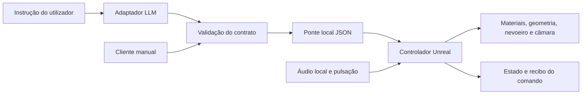

# Ambiente audiovisual inspirado no Fantasynth — especificação inicial

Data: 2026-10-11. Estado: proposta anterior de Unreal, substituída por [especificação C++](2026-10-11-fantasynth-cpp-design.md). Conservada como histórico; não orienta a implementação atual.

## 1. Objetivo e âmbito

Construir uma aplicação própria visualmente semelhante ao Fantasynth, com geometria procedural, materiais luminosos, movimento de câmara e pulsação musical. O utilizador descreve o ambiente pretendido em linguagem natural; um LLM propõe parâmetros JSON; a aplicação valida e aplica esses parâmetros durante a execução, com transições suaves.

O primeiro marco é uma cena controlável através de JSON enviado manualmente. O segundo liga o LLM ao mesmo contrato. A investigação do original serve para identificar mecanismos e referências úteis à reconstrução; não é necessário descompilar toda a aplicação para iniciar o protótipo.

Pressupostos adotados para esta especificação:

- Primeira versão para monitor, em Windows, com uma futura adaptação a VR. A preferência monitor/VR não foi explicitamente respondida; este pressuposto deve ser revisto se VR for prioritária.
- Projeto novo em Unreal Engine 5. A versão exata será fixada no plano de implementação depois de confirmar a instalação e a cadeia de compilação; os recursos compilados para UE 4.13 não serão tratados como recursos editáveis de UE5.
- Uma cena, uma aplicação local e um controlador externo. Sem colaboração, servidor remoto ou catálogo de ambientes no primeiro marco.
- Malhas, materiais e lógica próprios. Os ficheiros extraídos para investigação permanecem separados dos recursos do produto.
- LLM desacoplado do motor, através de um adaptador substituível. O primeiro marco usa um cliente manual e respostas simuladas; não depende de conta ou fornecedor de LLM.

## 2. Evidência local e limites da investigação

| Identificador | Observação verificada | Alcance |
| --- | --- | --- |
| LOCAL-ENGINE-01 | `fantasynth-version.txt` identifica UE 4.13.2, changelist 3172292. | Identifica a versão do motor; não explica a lógica visual. |
| LOCAL-PAK-01 | Pacote de 259 630 388 bytes, formato PAK v3, 1 696 entradas. SHA-1 do índice: `dad3302f199ac29abb213f2e9632a7f9bced2c48`, validado contra o índice lido. | Inspeção binária com Python; não é um resultado REA. |
| LOCAL-CONFIG-01 | `Fantasynth/Config/DefaultEngine.ini` define `GameDefaultMap=/Game/_HelloEnjoy_/ChezNous/Levels/ChezNous.ChezNous`. O tamanho e SHA-1 do conteúdo lido foram verificados. | Confirma o mapa configurado para arranque. |
| LOCAL-ASSETS-01 | O índice contém recursos como `BeatDirector`, `BeatActionSequencer`, `SequenceManager`, `ScatterComponent`, `FogColorController`, materiais emissivos e faixas `ChezNous_KICK`, `LOW`, `RHYTHM`, `SYNTHS`, `THEME` e `MASTER`. | São nomes e caminhos observados. Sugerem pontos de investigação, mas não provam execução, análise FFT ou ligação entre parâmetros. |
| REA-PE-01 | `inspect_pe_resources` identifica o executável como PE32+, máquina 34404 (x64), com 42 256 896 bytes. SHA-256: `5380708aaf59992814912122afc3f71d6b18bd41062cde1a5e04fcec4e9f191b`. | Inventário estático dos recursos PE; não é descompilação. |
| LOCAL-PROVIDERS-01 | O diagnóstico guardado indica Ghidra e IDA indisponíveis, Hopper não suportado em Windows e `JAVA_HOME` a terminar em `bin`. | Estado registado no diagnóstico; requer nova verificação após qualquer configuração. |

Evidência REA de REA-PE-01: `ev_864e282606d22f314b5bc5f3deb56d9bb1aa167ef551411a076935810b28d3bf`.

Artefactos duráveis neste diretório:

- `fantasynth-pak-inventory.json`: entradas, deslocamentos, tamanhos e hashes do índice.
- `fantasynth-pak-observations.json`: contagens e correspondências selecionadas das configurações.
- `rea-fantasynth-pe-resources.json`: resultado completo da inspeção REA.
- `rea-artifact-directory-error.json`: registo de uma tentativa não suportada de abrir o diretório por uma rota que exige um ficheiro. Não constitui evidência positiva sobre o produto.

Permanece por determinar como as sequências, faixas musicais, materiais e componentes se ligam no original. Não está demonstrada uma interface externa de controlo, nem foram observados os efeitos do original em execução nesta investigação.

## 3. Primeira cena proposta

Cena de trabalho: **Campo de luz**. Esta é uma proposta para o produto, não uma descrição já comprovada de uma cena específica do original.

- Piso escuro, com uma grelha de colunas e formas geométricas repetidas, organizadas em faixas que criam profundidade.
- Malhas simples instanciadas, com uma distribuição reproduzível a partir de uma semente fixa (`20261011`).
- Materiais com cor e emissão reguláveis; brilho, nevoeiro e iluminação ambiente ajustáveis.
- Câmara que avança por um percurso contínuo, sem cortes ou movimentos bruscos.
- Pulsação que modula a emissão e uma pequena deformação visual dos elementos.
- Dois canais de cor: principal e secundário, inicialmente ciano e violeta.
- Três estados de referência: calmo, equilibrado e energético, definidos como combinações dos mesmos parâmetros.

A semelhança será avaliada com excertos visuais de referência, escolhidos antes de fechar a cena. Critérios: composição espacial, repetição geométrica, contraste entre superfícies escuras e luminosas, comportamento dos movimentos e relação dos efeitos com a música. A inventariação de recursos não substitui esta comparação visual.

## 4. Arquitetura e fluxo



| Unidade | Responsabilidade | Interface |
| --- | --- | --- |
| Adaptador LLM | Converter texto em propostas de parâmetros; descartar respostas de instruções ultrapassadas. | Mesmo contrato JSON usado pelo cliente manual. |
| Validador | Rejeitar mensagens inválidas, campos desconhecidos, números não finitos e valores fora dos limites. | Comando validado ou erro explícito; validação repetida no motor. |
| Ponte local | Entregar comandos e receber confirmações, sem bloquear a renderização. | TCP sobre `127.0.0.1:47631`, mensagens JSON UTF-8 delimitadas por uma quebra de linha; máximo 16 KiB por mensagem. |
| Controlador Unreal | Aplicar o estado no ciclo da aplicação, interpolar valores e combinar a modulação musical. | Estado atual, estado pretendido e recibos. |
| Cena | Traduzir os parâmetros para propriedades visuais concretas. | Materiais dinâmicos, coleções de parâmetros e componentes próprios. |
| Áudio | Produzir uma envolvente normalizada de amplitude e eventos de pulsação. | Dados locais normalizados, sem chamadas ao LLM por frame. |

Escolha proposta para a ponte: módulo C++ de execução do Unreal, com receção numa tarefa separada e entrega ao controlador na thread do jogo. O controlador externo será em Python, com gestão de dependências por `uv`. Nenhum destes módulos é criado nesta fase de especificação.

O TCP com mensagens delimitadas por linha reduz dependências do primeiro protótipo e permite testar um executável empacotado. A Remote Control API pode ajudar a explorar o editor, mas não será a única ligação do produto: a ponte terá de funcionar numa aplicação autónoma. A porta em uso deve produzir um erro visível e permitir configurar outra porta no arranque.

## 5. Contrato de controlo v1

Exemplo de um comando válido:

```json
{
  "schema_version": 1,
  "id": "demo-calm-001",
  "command": "apply_parameters",
  "transition_seconds": 3,
  "parameters": {
    "palette": ["#00FFFF", "#7722FF"],
    "light_intensity": 0.6,
    "motion_speed": 0.3,
    "pulse_strength": 0.4,
    "fog_density": 0.2,
    "geometry_density": 0.5,
    "bloom": 0.35
  }
}
```

Campos do envelope:

| Campo | Regra |
| --- | --- |
| `schema_version` | Obrigatório; inteiro igual a `1`. |
| `id` | Obrigatório; cadeia de 1 a 64 caracteres ASCII, apenas letras, números, hífen e sublinhado. |
| `command` | Obrigatório; valor `apply_parameters`. |
| `transition_seconds` | Obrigatório; número finito entre 0,1 e 15 segundos. |
| `parameters` | Obrigatório; objeto com pelo menos um dos parâmetros abaixo. Atualização parcial e atómica. |

Parâmetros expostos:

| Parâmetro | Tipo e limites | Valor inicial | Significado visual |
| --- | --- | --- | --- |
| `palette` | Dois valores `#RRGGBB`. | `["#00FFFF", "#7722FF"]` | Cor principal e secundária; interpolação em espaço linear. |
| `light_intensity` | Número finito de 0 a 1. | 0,6 | Multiplicador normalizado da iluminação e emissão base. |
| `motion_speed` | Número finito de 0 a 1. | 0,3 | Velocidade de avanço da câmara, mapeada para 0–250 cm/s. |
| `pulse_strength` | Número finito de 0 a 1. | 0,4 | Amplitude da modulação musical. |
| `fog_density` | Número finito de 0 a 1. | 0,2 | Densidade do nevoeiro dentro do intervalo artístico calibrado da cena. |
| `geometry_density` | Número finito de 0 a 1. | 0,5 | Quantidade visual de elementos ativos; nunca ultrapassa o orçamento fixo da cena. |
| `bloom` | Número finito de 0 a 1. | 0,35 | Intensidade do brilho dentro do intervalo artístico calibrado da cena. |

Os valores são controlos normalizados da aplicação, não unidades físicas do Unreal. A calibração artística de nevoeiro, emissão e brilho será guardada na configuração da cena e mantida fora do alcance do LLM.

Semântica:

- Campos omitidos em `parameters` mantêm o seu estado pretendido anterior; o comando não repõe valores iniciais.
- O envelope e o objeto de parâmetros rejeitam propriedades desconhecidas. Chaves JSON duplicadas são rejeitadas. Valores booleanos não são aceites como números.
- O comando inteiro é rejeitado se algum valor for inválido; não há aplicação parcial nem correção silenciosa dos valores.
- Não são aceites caminhos de objetos Unreal, nomes de funções, código, comandos de consola ou ficheiros arbitrários.
- Ao aceitar um comando, o controlador parte do estado visual atual. Um comando novo substitui os destinos anteriores sem regressar ao ponto de partida da transição antiga.
- A interpolação usa tempo decorrido, não contagem de frames, com suavização `3t²−2t³` para `t` entre 0 e 1.
- A densidade geométrica é aplicada dentro de um conjunto limitado de elementos preparados; as mudanças são distribuídas ao longo dos frames para evitar uma reconstrução síncrona do nível.
- A pulsação musical é somada à animação base e limitada aos intervalos visuais calibrados. As instruções do LLM não substituem a deteção local de áudio.

Exemplo de confirmação de aceitação:

```json
{
  "schema_version": 1,
  "id": "demo-calm-001",
  "status": "accepted",
  "revision": 12
}
```

`accepted` significa que o comando foi validado e entregue ao controlador na thread do jogo; não significa que a transição já terminou. `revision` é um contador crescente durante a execução. O estado consultável inclui a revisão, os valores atuais, os valores pretendidos e o progresso da transição.

Um erro devolve `status: "rejected"`, o identificador quando for recuperável, um `error_code` e os nomes dos campos inválidos. Uma mensagem inválida não modifica o estado nem a revisão.

## 6. Áudio, latência e falhas

Primeiro marco: ficheiro WAV local e sinal de teste com pulsação conhecida. O sinal de teste permite validar as transições sem depender de conteúdo musical do original. A primeira análise produz amplitude suavizada; a deteção de batidas é validada separadamente. Entrada ao vivo fica para o marco seguinte.

O LLM só participa quando há uma instrução do utilizador. A renderização, a câmara e a reação musical mantêm-se ativas durante a inferência. Quando chega uma instrução nova, o adaptador marca a anterior como ultrapassada e não aplica respostas que cheguem tarde.

Desligar o controlador ou falhar o LLM mantém o último estado aceite. JSON inválido produz uma mensagem de erro e mantém a cena. Um controlo manual de pausa da câmara e reposição do estado inicial continua disponível independentemente do LLM.

Metas de validação, ainda não medidas:

- Primeira alteração visível até 100 ms após receção local do comando, sem contar a latência do LLM.
- Transições terminam no intervalo definido, com tolerância de dois frames.
- Objetivo inicial de 60 FPS a 1920×1080 na GPU NVIDIA RTX 2060 Max-Q identificada nesta máquina; registar as condições e ajustar a qualidade se a meta não for atingida.
- Primeiro perfil gráfico com geometria simples instanciada, sem dependência de ray tracing ou Lumen para obter o aspeto pretendido.
- Limite inicial de 4 096 elementos geométricos, com orçamento de atualização distribuída a verificar por medição.

## 7. Critérios de aceitação

1. A cena pode ser lançada como aplicação Windows empacotada e recebe comandos de um cliente externo.
2. Cada parâmetro tem um efeito identificável e distinto, demonstrado por comparação antes/depois com semente fixa.
3. O comando de exemplo altera o ambiente sem reiniciar, sem recompilar materiais e sem bloquear a câmara.
4. Numa transição a decorrer, uma atualização nova mantém continuidade visual e termina no novo destino.
5. Testes de campos desconhecidos, limites, mensagens incompletas, NaN, infinito, chaves duplicadas e tamanho excessivo demonstram rejeição sem alteração do estado.
6. Desligar o cliente ou simular erro do LLM mantém a cena funcional.
7. O sinal de teste demonstra modulação sincronizada; a medição identifica separadamente atraso de áudio, entrega do comando e transição visual.
8. A aplicação regista comando, revisão, tempos de receção/aceitação e resultado, permitindo repetir uma sessão através de uma sequência de JSON.
9. A ligação ao LLM interpreta pelo menos as instruções «mais escuro e lento», «mais energético» e «menos elementos e nevoeiro», produzindo alterações dentro do contrato.
10. A avaliação visual compara a cena com uma referência selecionada do Fantasynth; a proximidade estética é avaliada separadamente da integração técnica.

## 8. Marcos e dependências

| Marco | Entregável | Condição para avançar |
| --- | --- | --- |
| M0 — referência e desenho | Esta especificação, inventário do pacote e seleção visual da referência. | Revisão da especificação e confirmação/correção do pressuposto monitor. |
| M1 — cena e JSON manual | Cena reproduzível, ponte local, validação e transições num executável empacotado. | Critérios 1–6 e medição de desempenho. |
| M2 — áudio e repetição | Modulação local, registo e reprodução de comandos. | Critérios 7–8. |
| M3 — LLM | Adaptador de fornecedor, inferência assíncrona e instruções naturais. | Critérios 9–10. |

Antes da implementação: confirmar instalação do Unreal, versão, compilador C++, espaço disponível e configuração de execução. Não foi encontrado Unreal nos caminhos habituais inspecionados; isso não prova ausência noutra localização. O fornecedor/modelo LLM será escolhido antes de M3; M1 e M2 permanecem independentes dessa escolha.

Ghidra só será preparado quando uma questão concreta exigir análise do executável. A investigação dos nomes e configurações já permite especificar a nossa cena, mas não substitui a futura análise da lógica de sequências do original.

## 9. Fontes e validação do desenho

- [Coleções de parâmetros de materiais — Epic](https://dev.epicgames.com/documentation/unreal-engine/using-material-parameter-collections-in-unreal-engine): suporte a parâmetros escalares/vetoriais partilhados.
- [Remote Control Quick Start — Epic](https://dev.epicgames.com/documentation/unreal-engine/remote-control-quick-start-for-unreal-engine): controlo por JSON no editor; não constitui validação da nossa ponte ou aplicação empacotada.
- [Requisitos de hardware — Epic](https://dev.epicgames.com/documentation/en-us/unreal-engine/hardware-and-software-specifications-for-unreal-engine): referência para preparar a cadeia de desenvolvimento; não garante o desempenho desta cena.
- [Formato PAK — CUE4Parse](https://github.com/FabianFG/CUE4Parse/tree/master/CUE4Parse/UE4/Pak): fonte primária do analisador usado como referência para o formato do índice. Não foi instalado nem executado CUE4Parse; a leitura local foi efetuada com Python.

Auto-revisão: objetivo, fronteiras dos componentes, semântica das atualizações, validação, falhas e critérios de teste estão definidos. As metas de desempenho, a semelhança visual e o comportamento do original permanecem explicitamente não demonstrados. A pasta ainda não é um repositório Git; não foi criado um repositório nem efetuado um commit nesta fase.
