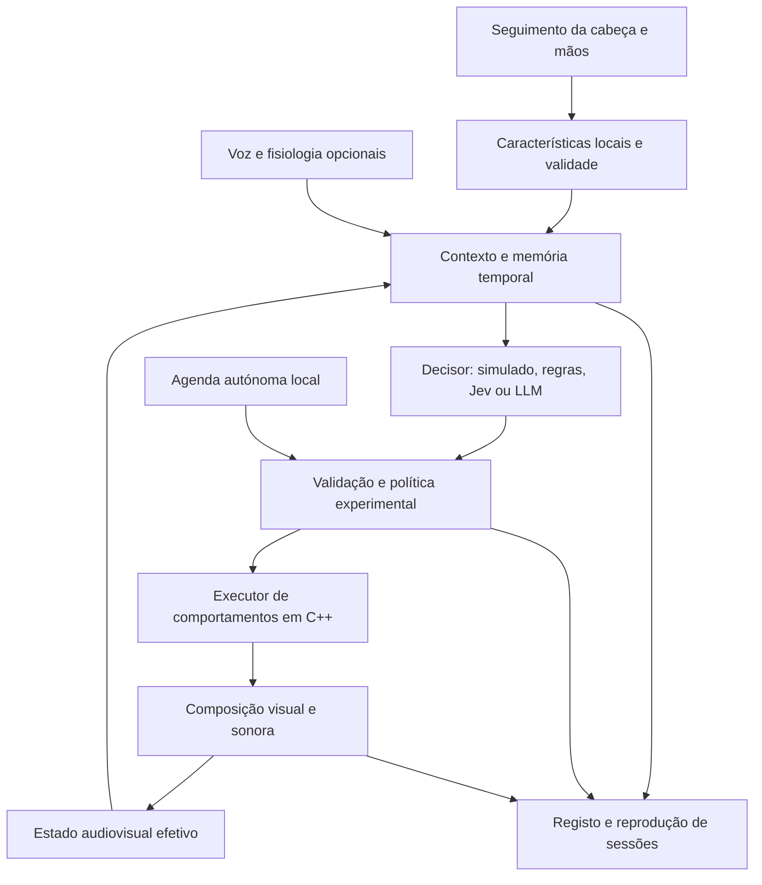

# Implementação dos repertórios semânticos do Fantasynt

Data: 2026-10-14 · Estado: plano de implementação · Base inspecionada: 0.12.0

## Objetivo e âmbito

Criar uma infraestrutura para um ambiente não figurativo com continuidade, contingência parcial e iniciativa própria, permitindo investigar a atribuição de agência ao ambiente e a ambiguidade entre essa atribuição e o prolongamento da agência do utilizador.

O primeiro incremento implementa **sustentar, ressoar e iniciar**, com leitura conjunta de corpo, ambiente e história. O segundo acrescenta **propagar e contrastar**. As definições e os limites estão no [repertório](repertoire.md); os factos verificados e fontes estão nas [notas](notes.md).

Requisitos confirmados: Quest 3, seguimento das mãos e da cabeça, sem controladores; contexto preparado para voz e fisiologia, sem as tornar obrigatórias. Jev é um candidato substituível. Os nomes das políticas, interpretações e painel do investigador ficam fora da experiência do participante.

Esta entrega é documental. Os módulos, contratos, testes e valores de configuração abaixo são propostos e ainda não estão implementados.

## Arquitetura proposta

- **C++:** aquisição OpenXR, execução temporal, composição, áudio, limites e interrupção local. Nenhuma chamada remota na renderização ou no processamento de áudio.
- **Python, gerido por uv:** agregação de contexto, memória de episódios, adaptadores dos decisores, avaliação e painel local do investigador. Instalar uv durante a implementação se não estiver disponível; não é requisito do pacote portátil final sem o serviço semântico.
- **Configuração:** YAML versionado para repertório, rubricas e condições; JSON tipado para comunicação. Começar com validação simples; Hydra/OmegaConf pode compor variações experimentais quando houver várias condições.
- **Fornecedor remoto:** recebe resumos temporais delimitados; credenciais ficam no serviço local. A porta do motor continua restrita a loopback.

## Ordem de implementação

### M0 — Contratos, capacidades e linha de base

**Trabalho:** congelar uma cópia identificada da aplicação/configuração atual; inventariar cada atuador por unidade, limites, custo, cena/fase, modo de atualização e efeito efetivo. Registar os sete controlos de rede atuais e os controlos adicionais necessários. Fazer uma reprodução e capturas de referência em fases representativas antes de alterar o motor.

Definir os contratos descritos abaixo, o significado de cada comportamento e a configuração experimental inicial. Manter percurso, velocidade da câmara e relógio musical fixos na primeira comparação. Resolver a prioridade entre coreografia e adaptação; não usar reescritas repetidas de `visual-config.json` como interface de execução semântica.

**Entregáveis:** catálogo de capacidades; contratos versionados; fichas dos três comportamentos iniciais; cópia de referência e registo de versões/hashes.

**Aceitação:** cada parâmetro anunciado tem efeito observável ou aparece explicitamente indisponível nessa fase. A versão 1 continua a aceitar/rejeitar os exemplos e erros conhecidos. Os testes existentes relevantes passam na linha de base, ou as falhas prévias ficam identificadas antes de mudanças.

**Dependências:** nenhuma. É o primeiro trabalho a executar.

### M1 — Observação e reprodução, sem adaptação

**Trabalho:** detetar `XR_EXT_hand_tracking` na instalação e adquirir articulações válidas, cabeça e tempos. Acrescentar suporte simulado nos testes. Separar movimento físico de deslocação virtual e não calcular velocidade através de saltos de recentragem ou segmentos inválidos. Registar referência espacial e mudanças de origem.

Usar o tempo de consulta das poses, incluindo o facto de serem previstas quando aplicável, e um relógio monotónico local. Relacionar explicitamente estes tempos com a posição do áudio; não tratar o instante de receção no Python como instante do movimento. Conservar qualidade/cobertura por fonte.

Extrair descritores e episódios de múltiplas fontes. Criar exportação e reprodução de observações com exemplos de imobilidade válida, perda de mãos, mudança de origem, evolução autónoma do ambiente e modalidades ausentes. Acrescentar o estado efetivo depois da composição assim que M2 estiver disponível.

**Entregáveis:** telemetria, `ContextSnapshot`, ficheiros de sessão, reprodutor e painel simples do investigador.

**Aceitação:** perda de seguimento nunca equivale a imobilidade; deslocação automática da cena nunca equivale a deslocação corporal; cabeça/mãos/áudio têm tempos correlacionáveis; painel e escrita em disco não bloqueiam o ciclo gráfico. Reprodução gera os mesmos descritores, dentro de tolerâncias documentadas. Teste real nos Quest é obrigatório para declarar a aquisição operacional.

**Dependências:** M0. O desenvolvimento dos descritores pode usar exemplos sintéticos, mas não substitui a prova no headset.

### M2 — Executor local e três comportamentos

**Trabalho:** construir máquina de estados com início, duração, transição, expiração e cancelamento; executar planos simulados e os três comportamentos iniciais. Respeitar permanência mínima e limites de variação. A agenda autónoma permite iniciar sem um evento corporal; a sua semente, orçamento e regras ficam registados.

Criar uma composição explícita: base artística → modulação do comportamento → limites locais e intervenção manual. Com adaptação desligada, o caminho base produz o resultado anterior. Registar separadamente base, contribuição e resultado efetivo. Os envelopes experimentais imutáveis não podem ser ultrapassados por decisões remotas.

Acrescentar ganho sonoro com curvas suaves, mantendo o relógio e a posição do MASTER. Ressoar usa um motivo calculado e validado localmente, não uma estimativa numérica inventada pelo modelo. A primeira realização sonora pode limitar-se a modulação de ganho; deve ser identificada como tal. Acrescentar processamento ou camadas de áudio apenas com qualidade e material verificados.

**Entregáveis:** executor C++, composição, ganho sonoro e demonstrações reproduzíveis dos três comportamentos em fases relevantes da experiência.

**Aceitação:** sem saltos na substituição de uma política; comandos visuais e sonoros partilham o agendamento de sessão; pausa/reinício são coerentes; não há clipping introduzido nem desvio do relógio musical. A coreografia não anula silenciosamente o efeito anunciado. Teste de stress confirma que o serviço remoto desligado não impede execução ou interrupção.

**Dependências:** M0; exemplos de M1 para ressoar. M1 e partes do executor podem ser desenvolvidos separadamente depois de fixados os contratos.

### M3 — Contexto holístico e Jev em observação

**Trabalho:** implementar a interface comum dos decisores e começar por `ReplayProvider`/`RulesProvider`. Integrar Jev com seleção entre comportamentos elegíveis e critérios com exemplos/contraexemplos. Usar uma escolha principal e validar dimensões auxiliares compatíveis. Limitar o contexto ao episódio e memória relevantes, sem o reduzir a um rótulo corporal.

Rubricas propostas: continuidade do motivo observável, existência de mudança comportamental após um acontecimento, adequação de manter ou rever a política segundo a condição. Não perguntar se o utilizador sente agência, se o ambiente tem agência ou se uma mudança observada prova causalidade. Grandezas computáveis, cobertura e tempos são determinados em código.

Avaliar primeiro sobre episódios registados. Jev devolve propostas para o painel, sem as executar. Comparar com regras fixas e, se disponível, um LLM de saída estruturada, usando o mesmo contexto e repertório. Testar ordem das opções, contexto incompleto, repetição e condições contraditórias. Fixar versões de modelo, rubricas e mapeamentos; não usar um alias mutável durante um estudo.

**Entregáveis:** adaptador Jev; rubricas; conjunto de episódios de desenvolvimento e avaliação separados por sessão/participante; relatório de decisões e latência.

**Aceitação:** todas as respostas inválidas, incompatíveis, ultrapassadas ou fora de capacidades são rejeitadas; são registadas abstenções e falhas. Medir cobertura, estabilidade temporal, discordância com anotações de investigadores e distribuição de latências, sem confundir concordância com uma verdade psicológica. Definir os limiares de confiança após esta avaliação e congelá-los antes da comparação com participantes.

**Dependências:** M1 e interface de M2. Pode iniciar-se com exemplos gravados sem credenciais; as medições do fornecedor real exigem acesso à API.

### M4 — Ciclo adaptativo limitado e expansão do repertório

**Trabalho:** ligar decisões validadas ao executor, aplicar deduplicação, expiração e prevenção de alternância rápida. Primeiro testar sustentar/ressoar/iniciar em sessões técnicas. Acrescentar grupos espaciais estáveis para propagar e um caminho sonoro adequado. Introduzir contrastar com restrição a uma dimensão dominante por episódio.

A existência de uma região visual não prova espacialização sonora. Para declarar propagação audiovisual, demonstrar a progressão nos dois canais; caso o som permaneça global, documentar essa realização parcial. Não pressupor a disponibilidade de pistas separadas a partir de nomes históricos de recursos.

**Entregáveis:** cinco comportamentos validados tecnicamente, demonstrações por comportamento, matriz de compatibilidade e pacote de ensaio sem controladores.

**Aceitação:** comportamento reproduzível e visível/audível; parâmetros preservados mantêm-se dentro da tolerância; falhas técnicas não geram acontecimentos artísticos; não há escalada contínua quando movimento e estimulação se reforçam. Testar interrupção pelo operador e um mecanismo acessível ao participante, independente da rede e do sucesso do seguimento das mãos. Até essa opção ser validada, manter ensaios técnicos supervisionados.

**Dependências:** M2 + M3. A expansão espacial e sonora não bloqueia o primeiro ciclo com três comportamentos.

### M5 — Piloto experimental e fixação do protocolo

**Trabalho:** verificar se os comportamentos são suficientemente distintos e se a contingência é identificável na condição transparente. Comparar inicialmente contingência transparente, contingência opaca e reprodução independente, mantendo conteúdos, envelopes de estimulação, duração e latência técnica tão comparáveis quanto possível. A latência artística introduzida pela condição é registada separadamente da latência técnica.

Na reprodução independente, fixar a realização audiovisual de uma sessão de origem e a semente; os sinais atuais não influenciam o comportamento. Preservar apenas a interrupção local. Registar sessão de origem e alinhamento temporal. Contrabalançar ordem e controlar aprendizagem/fadiga no desenho final.

Recolher separadamente agência atribuída ao ambiente, agência própria, controlo percebido, previsibilidade e descrições abertas. A ambiguidade não deve ser definida apenas como um valor médio numa escala única. Selecionar instrumentos e plano de análise com revisão bibliográfica própria; este documento não valida escalas nem calcula amostra.

Comparar Jev com regras/LLM e comparar opacidade são perguntas diferentes. Não cruzar todos os fatores no primeiro piloto. Primeiro validar o artefacto e a manipulação; depois isolar a contribuição do decisor. Não otimizar o decisor online para aumentar os relatos de agência durante o ensaio confirmatório.

**Entregáveis:** protocolo, manipulações verificadas, plano de análise, configurações congeladas e conjunto de sessões reproduzíveis.

**Aceitação:** atribuição de agência avaliada por dados dos participantes, não pelos rótulos de Jev; perdas técnicas e condições de exclusão definidas antes da análise; nenhum resultado exploratório apresentado como confirmação da hipótese.

**Dependências:** três comportamentos estáveis de M4 bastam para um primeiro piloto; cinco não são requisito científico automático.

## Contratos e integração com o projeto

| Contrato proposto | Campos/conteúdo essenciais | Responsável |
|---|---|---|
| `ObservationFrame` | Sessão, sequência, tempo de consulta/receção, espaço, fontes, valores, validade, cobertura. | Aquisição C++; registo local. |
| `ContextSnapshot` | Intervalo temporal, observações resumidas, estado efetivo, episódios, hipóteses separadas, capacidades, condição e versões. | Serviço Python. |
| `BehaviorDecision` | Referência ao contexto, escolha, distribuição/confiança quando disponível, decisor e rubrica. | Adaptador substituível. |
| `BehaviorPlan` | ID idempotente, comportamento, motivo, envelope, início/fim, contexto de origem, versão da condição, expiração. | Política local; validada novamente no C++. |
| `EffectiveState` | Base, modulação e resultado aplicado; fase musical; estado das transições e capacidades. | Motor C++. |
| `SessionEvent` | Observação/contexto/decisão/plano/recibo, tempos, versões e causa técnica de rejeição ou substituição. | Componentes locais correlacionados. |

Evolução proposta do protocolo: manter `apply_parameters` v1; adicionar v2 com consulta de capacidades/estado, aplicação e cancelamento de plano, e estados de ciclo de vida. Uma consulta não modifica a revisão. Revisão da configuração/condição é distinta do contador de amostras de telemetria, para que toda resposta remota não fique automaticamente obsoleta.

Expiração baseia-se em relógio local e contexto, não no relógio do fornecedor. Planos duplicados devolvem o estado conhecido sem repetir efeitos. O motor rejeita revisões incompatíveis e contextos anteriores ao último aceite para a mesma decisão. Nunca repetir cegamente uma ação após um timeout.

Telemetria usa um canal/conexão separado dos comandos, com filas limitadas e descartes contabilizados; não enviar esqueletos completos a cada frame pelo enquadramento v1 de 16 KiB. O serviço remoto recebe resumos. Escrita de registos fica fora dos ciclos críticos; se houver perda de dados necessária à análise, o segmento é marcado como incompleto.

## Organização de código proposta

| Localização futura | Responsabilidade |
|---|---|
| `src/interaction/` | Aquisição normalizada, validade e referências temporais/espaciais. |
| `src/behavior/` | Planos, ciclos de vida, agenda autónoma e composição dos comportamentos. |
| `src/control/` e `src/net/` | Evolução compatível do contrato e telemetria com limites. |
| `src/audio/` | Envolventes de ganho; efeitos/camadas em incremento posterior. |
| `src/render/` | Estado efetivo, prioridade artística e seleção de grupos para propagação. |
| `services/semantic/` | Contexto, memória, decisores, avaliação e painel local; projeto Python com uv. |
| `config/repertoires/v1/` | Fichas dos comportamentos e mapeamentos por cena. |
| `config/experiments/` | Condições e envelopes imutáveis por bloco. |
| `tests/fixtures/interaction/` | Episódios sintéticos e anonimizados para regressão. |

Não criar antecipadamente módulos vazios. Acrescentar cada componente no marco que o utiliza, com testes de comportamento e revisão de código antes da integração.

## Temporização inicial para ensaios técnicos

Valores propostos, ajustáveis por medição: aquisição à cadência disponibilizada pelo runtime; publicação de descritores locais a 20 Hz; contexto com janelas curta de 2 s e de episódio de 10 s, mais memória limitada; avaliação remota a cada 2 s ou por acontecimento relevante, com apenas uma chamada ativa e conservação do pedido mais recente. Permanência mínima inicial de 4 s e transição de 2 s. Congelar os valores antes de comparar condições.

Estes números não são latências garantidas nem parâmetros cientificamente validados. Medir aquisição→descritor, descritor→pedido, ida/volta remota, aceitação→aplicação e aplicação→efeito observável separadamente. O orçamento de VR depende da frequência efetiva do headset. A aplicação e o áudio nunca aguardam o fornecedor.

Nos ensaios controlados, usar uma agenda de aplicação comum quando necessário para comparar decisores; registar decisões que perdem o prazo. Não esconder atrasos técnicos como opacidade causal intencional.

## Validação mínima antes da primeira sessão adaptativa

- Regressão: execução base, JSON v1, composição, áudio e relógio musical.
- Aquisição: mãos ausentes/ocultas, cabeça inválida, recentragem, suspensão da sessão e retoma.
- Políticas: substituição em transição, duplicação, expiração, pausa/reinício e configuração incompatível.
- Robustez: serviço desligado, resposta inválida, resposta atrasada, fila saturada e indisponibilidade de áudio.
- Reprodução: mesmo plano, semente e registo produzem trajetórias equivalentes dentro de tolerâncias; igualdade de píxeis entre GPUs não é pressuposta.
- Evidência real: observação no Quest 3, capturas e áudio gravado, sem concluir a partir do runtime simulado que o seguimento ou o som funcionam no equipamento.

## Decisões que permanecem abertas

Visibilidade das mãos, escolha de efeitos/pistas sonoras, extensão de sessões e instrumentos de avaliação. Para o desenvolvimento técnico, mãos visíveis apenas na vista de diagnóstico, sem avatar no ambiente do participante; voz e fisiologia desativadas. Estas opções iniciais são configuráveis e terão de ser fixadas no protocolo antes de recolher dados comparativos.

Como não há Git identificado na raiz, o início de implementação deve criar uma cópia de segurança delimitada dos ficheiros alterados e do executável/configuração de referência. Não substituir pacotes distribuídos. A ligação ao Obsidian aguarda um caminho de vault e resolução da divergência de diretório descrita nas notas; o plano local está completo independentemente dessa ligação.

## Próxima tarefa concreta

**Executar M0 e iniciar M1:** catálogo efetivo de capacidades, contratos e registo sincronizado de cabeça, mãos e ambiente. O resultado esperado é uma sessão que pode ser inspecionada e reproduzida, ainda sem decisões remotas a alterar a experiência. Depois, M2 concretiza os três comportamentos através de planos simulados; M3 avalia se Jev consegue escolhê-los com consistência.
