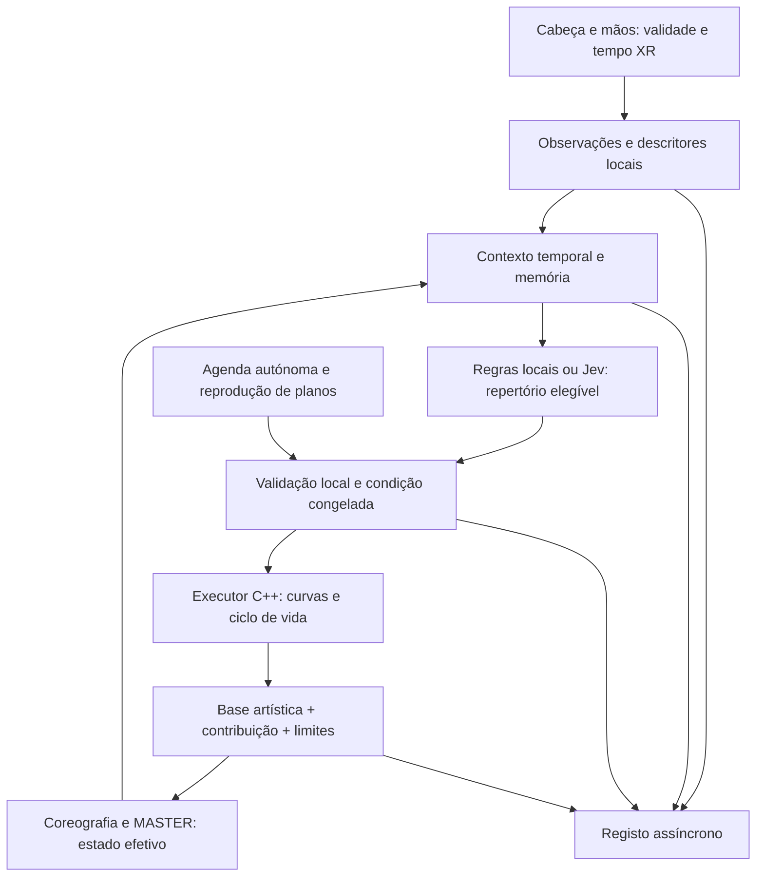

# Plano técnico executável — primeira exposição

**Estado de 2026-10-15:** P0 e mãos 3D implementados; P1 programado autorizado e implementado em [p1-motifs-2026-10-15](../p1-motifs-2026-10-15/README.md). Usa a família diminuição longa e agenda fixa, sem seleção corporal/LLM. Verificação física de áudio/efeito P1 pendente. P2–P5 e as variantes de curvas continuam propostas. O texto datado abaixo conserva a especificação de referência.

Data: 2026-10-14 · Revisão 2 · Base inspecionada: 0.12.0, `bc86e22` · **P: implementação futura; nesta tarefa só documentação.**

## Resultado a implementar

Executar a [sessão de 7:04,18](first-session.md) com sustentar, ressoar e iniciar, memória de motivos, aquisição holística de cabeça/mãos/ambiente e três condições entre participantes. O [repertório](repertoire.md) fixa a realização mínima; [notes.md](notes.md) documenta capacidades por fase; [behavior-matrix.md](behavior-matrix.md) fixa registos; [first-exposure-protocol.md](first-exposure-protocol.md) define avaliação e decisões abertas.

Não implementar tudo antes de observar: primeiro aquisição e estado efetivo, depois executor com motivos simulados, depois contingência local e reprodução independente. Jev é um adaptador opcional posterior. Os marcos P0–P5 abaixo substituem M0–M5 do documento anterior; as extensões espaciais/sonoras saem do caminho crítico.

## Fronteira decisor–execução

C++ adquire, calcula descritores exatos, mantém relógios/referências, valida sensores, aplica curvas e limites, decide disponibilidade por fase e interrompe localmente. Um `RulesProvider` local basta para o piloto mínimo; usa a mesma interface conceptual de decisões que um fornecedor externo. Python/uv entra quando forem necessários agregação/adaptadores/painel; não é dependência da renderização nem do áudio. Não criar diretórios/módulos vazios antecipadamente.

### Contexto temporal P

Publicar descritores a 20 Hz a partir da cadência XR disponível; manter observações de **2 s**, episódio de **10 s**, três episódios anteriores detalhados e resumo factual de toda a sessão. Valores iniciais, a medir e congelar. O contexto enviado ao decisor contém:

- Posição/orientação físicas e velocidades/variabilidade calculadas de cabeça; atividade/deslocação das mãos por fonte, relação cabeça–mãos e transições movimento/repouso. Não estimar olhar ocular, emoção, intenção ou desinteresse.
- Cobertura e flags de validade/seguimento, espaço/origem, tempos de consulta XR e de receção, modalidades ausentes. Não incluir valores zero para fontes inexistentes.
- Fase, tempo musical, base, paleta dirigida, composição/exposição, pulsos graves, câmara virtual, motivo/envelope aplicado, ganho comandado e capacidades efetivas. O MASTER analisado antes do ganho não é a saída sonora efetiva.
- Acontecimentos anteriores do ambiente e variações corporais antes/depois, ordenados temporalmente; efeitos rejeitados não contam como acontecimentos aplicados. Não converter sucessão em intenção demonstrada.
- Motivos com ancestralidade/proveniência, políticas anteriores, orçamento, janela protegida e oportunidades usadas; hipóteses anteriores em campo separado.
- Condição/versões imutáveis, escolhas elegíveis e próximo prazo. Não disponibilizar relatos subjetivos nem um objetivo de maximizar agência.

Não centrar contexto/decisão só nas mãos: com corpo igual e fase/memória diferentes, a escolha elegível pode mudar. Com mãos ocultas e cabeça válida, o contexto permanece útil. Com todas as fontes corporais estáticas, o ambiente/história continuam a orientar sustentar/iniciar.

### Extração inicial realizável de motivos P

Normalizar descritores por limiares físicos comuns, fixados em desenvolvimento; não recalibrar por percentis de cada pessoa durante o estudo. Cabeça: variação angular e deslocação física separados; mãos: velocidades/deslocações relativas ao espaço local e à cabeça, sem vocabulário de poses. Invalidar derivadas através de descontinuidades.

Um resumo de atividade pode usar pesos iniciais fixos cabeça 0,5, mão esquerda 0,25, direita 0,25, mantendo os descritores separados no contexto. Não renormalizar os pesos para ampliar uma mão/cabeça quando outra fonte falta; publicar cobertura. Os limiares numéricos de normalização/estabilidade são A até medições com ruído real; P0 fornece essas medições. Nenhum zero sintético substitui falta de dados.

Critério técnico inicial: cabeça válida em pelo menos 80% da janela, sem mudança de origem; cada fonte usada tem pelo menos 80% de cobertura. Exigir duas fases temporalmente distintas acima do limiar de diferença/ruído, cada uma com pelo menos 0,5 s; uma transição movimento→repouso é suficiente se satisfizer esse critério. Para uma curva com dois segmentos de mudança, exigir o padrão correspondente, sem o inventar a partir de uma única transição. Se não satisfizer, não há novo motivo corporal. O limiar de ruído por descritor é medido em registos de repouso/movimento técnicos e congelado. Estes 80%/0,5 s são propostas de engenharia, não critérios de agência ou atenção.

Extrair relações de duração entre períodos de variação/repouso; escolher a curva mais próxima na biblioteca finita, com tolerância explicitamente configurada e igual nas condições. Não inventar ritmo quando a série é irregular. Uma série irregular pode ser válida mas sem padrão elegível. A condição transparente usa a janela curta mais recente; a opaca usa a janela de episódio e liga o padrão ao motivo anterior, sob transformações temporais aprovadas. Mais descrição em [protocolo](first-exposure-protocol.md#condições-e-manipulação-p).

### Decisões autorizadas P

`BehaviorDecision` seleciona `sustain`, `resonate`, `initiate` ou `abstain` entre opções elegíveis, referencia um motivo elegível e, quando permitido, `preserve`/`retime` e `subtle`/`standard`. Não pode inventar regiões, números físicos, gestos ou nova política. No piloto, amplitude/duração ficam fixas por oportunidade; graduação livre só em ensaios de desenvolvimento separados.

Jev recebe o contexto estruturado e critérios ancorados nas fichas; escolhe uma política principal. Se várias perguntas forem usadas, a combinação é validada em código: as respostas independentes não garantem compatibilidade. Uma rubrica admissível pergunta qual continuação conserva o motivo e usa observações válidas; uma inadmissível pergunta se a pessoa sente agência. Confiança determina aceitar/abster-se conforme avaliação do adaptador; não se transforma em intensidade audiovisual. Versão do modelo/rubrica fixa antes de uma comparação; não se presume estabilidade de alias.

O código fixa comportamento inelegível, prazos, motivos calculados, unidades, amplitude, duração, acoplamento/opacidade, seed, iniciativa, capacidades, segurança e condição. O modelo nunca determina validade dos sensores ou força resposta quando o corpo está imóvel.

### Regras de memória e composição P

Um comportamento principal por instante, mistura apenas na transição de saída/entrada autorizada. Ciclo: elegível → agendado → entrada → desenvolvimento → saída → concluído; rejeição, expiração, substituição e cancelamento são eventos diferentes. A agenda tem três iniciativas nos horários comuns, não uma probabilidade crescente com silêncio.

Dois motivos correntes, até três episódios detalhados; resumo de IDs/curvas e ancestralidade permanece até fim de sessão. Retenção corrente de 90 s pode ser renovada; retorno de motivo mais antigo reconstrói-se a partir da curva aplicada arquivada, como retorno histórico, não observação corporal recente. Novos padrões corporais expiram aos 10 s. Memória só promove planos efetivamente aplicados.

Em Opening, compor depois de `directed_visual_parameters` e com conhecimento de `directed_composition`; não escrever repetidamente `visual-config.json`. No mínimo, subtrair o envelope à emissão global e aplicar ganho conforme [repertório](repertoire.md). Não modificar paleta, densidade, nevoeiro, bloom, velocidade, tempos de fase ou beat detector nas condições iniciais. O fade final é multiplicador artístico soberano; contribuição neutra até 392 s. Não compensar visualmente o fade nem o dip 208–220 s.

Adaptação desligada conserva código base/ganho 1. Pausa de sessão suspende relógio do executor e música; invalida pedidos pendentes. É alteração necessária: na base atual `SceneController::advance(dt)` continua durante pausa e os comandos v1 ainda são aceites. Não confundir essa interpolação existente com executor já sincronizado.

Congelar configuração/repertório/condição no arranque de estudo; rejeitar recarga artística/manual durante a sessão (a interrupção continua disponível). Registar tentativas. A base tem releitura a cada 0,25 s; é uma fonte real de alteração a eliminar no modo de estudo.

### Temporização e respostas impróprias P

No piloto local, cortar o contexto 0,5 s antes de cada oportunidade e aplicar no horário definido, nas três condições. O orçamento comum inclui cálculo/validação; resposta que não chega antes do início perde a oportunidade. Medir quanto do orçamento foi usado. A idade da observação e a retemporização artística da condição opaca ficam registadas separadamente.

Um adaptador remoto futuro publica a cada 2 s ou por episódio, com uma chamada ativa e retenção apenas do contexto mais recente. Não é o perfil temporal do piloto local. Só integrar na comparação depois de medir prazos e adotar a mesma agenda/buffer técnico em todas as condições. Não alongar a experiência para aguardar rede.

| Caso | Tratamento local e registo |
|---|---|
| Atrasada/expirada | Recusar se oportunidade já começou, contexto/epoch mudou ou versão não coincide; manter plano atual até fim, sem início retroativo. |
| Incompatível | Recusar comportamento/motivo/capacidade não elegível, região inexistente, duração/dose fora de condição ou janela protegida. |
| Baixa confiança | Abster-se; manter trajetória válida e usar continuação autónoma pré-autorizada na oportunidade, marcada como tal. Nada escala com confiança. |
| Duplicada | ID idempotente devolve estado conhecido; não reaplicar. Timeout não autoriza repetição cega. |
| Perda parcial de mãos | Invalidar fonte; terminar curva já calculada; usar cabeça/fonte restante apenas se elegível. Não gerar acento técnico. |
| Cabeça inválida/suspensão XR | Pausa técnica coordenada, novo segmento/origem se necessário, invalidar derivados e pedidos. Não prolongar relógio musical sem registo de interrupção. |
| Falha remota | Executor local conclui planos autorizados; depois base/agenda comum. Contabilizar oportunidades sem contingência. |
| Encerramento/interrupção | Cancelar pendentes; comando local prioritário, independente da rede e das mãos. |

### Contratos P, sem alterar v1 silenciosamente

| Contrato | Campos mínimos e responsabilidade |
|---|---|
| `ObservationFrame` | Sessão/seq, tempo monotónico, `XrTime`, origem/epoch, cabeça/mãos, flags/cobertura; C++ sem inferências psicológicas. |
| `EffectiveState` | Tempo musical/sessão, fase, câmara, base, composição/paleta dirigida, contribuição e resultado, ganho comandado, capacidades, clamps; C++. |
| `ContextSnapshot` | IDs/intervalos e observações, incerteza, episódios/motivos, versões/condição, opções elegíveis; local ou serviço Python. |
| `BehaviorDecision` | Contexto e versão, escolha/motivo/graduação elegíveis, decisor/versão, confiança/abstenção; fornecedor substituível. |
| `BehaviorPlan` | ID idempotente, epoch/condição, oportunidade, início/fim/prazo, curva/ancestralidade/proveniência, capacidades e dose; calculado/validado localmente. |
| `SessionEvent` | IDs correlacionados, observação/contexto/decisão/plano/estado, causa de rejeição/falha, tempos técnicos e artísticos; registo local. |

Manter `apply_parameters` v1 com erros/testes existentes. O mínimo local não precisa de rede v2. Quando entrar serviço externo, adicionar consulta de capacidades/estado e submissão/cancelamento de planos v2, incluindo recibos de agendamento/início/fim. Consultas não alteram revisão; contador de telemetria é distinto de revisão da condição/configuração. Uma nova amostra não torna automaticamente toda decisão obsoleta.

Telemetria/registo usam filas limitadas, escritor fora do ciclo gráfico, descartes contabilizados e marcador de integridade. Não enviar esqueletos pelo envelope v1 de 16 KiB. O código atual escreve/flush de recibos no ciclo principal; é E, não uma implementação assíncrona pronta.

## Alterações priorizadas

### P0 — Observação sincronizada e manifesto da sessão

**Prioridade obrigatória; primeira tarefa de programação.** Sem adaptação nem decisão remota. Fixar commit/build/configuração/áudio de referência e medir capacidades por fase, aproveitando o catálogo de [notes.md](notes.md).

**Ficheiros existentes:** `src/vr/openxr_session.hpp/.cpp` (extensão, trackers, poses e validade), `src/app/main.cpp` (correlação de relógios, eventos/origem e publicação), `src/render/art_direction.cpp`/`sequence.cpp` e `src/render/renderer.hpp/.cpp` (estado efetivo e fase, sem mudar direção artística), `src/audio/player.hpp/.cpp` (expor relógio/estado sem ganho novo), `CMakeLists.txt` e `tests/mock_openxr_runtime.cpp` para verificação. **Novos, quando utilizados:** `src/interaction/observation.hpp/.cpp`, escritor de sessão em `src/control/` ou módulo local de registo; testes de observação e fixtures. Não transformar `EyeView::head_world` renderizado/câmara virtual em deslocação física.

**Trabalho:** enumerar/habilitar `XR_EXT_hand_tracking` quando suportada, consultar capacidade do sistema, criar/destruir trackers e localizar articulações à referência/tempo apropriados; publicar falhas explicitamente. Exportar cabeça física com flags e `XrTime`; tratar mudanças de referência e eventos de suspensão. Capturar ambos os olhos a partir da mesma amostra lógica. Registar cabeçalho com hashes, condição `observe_only`, runtime, tempos e parâmetros efetivos. Deixar o corpo livre, sem comandos por gesto.

**Aceitação objetiva:**

1. Fixtures distinguem repouso válido, mãos perdidas, cabeça inválida, mudança de origem e avanço virtual; nenhuma derivada atravessa intervalo inválido/origem nova. Flags de posição e orientação são independentes.
2. Manifesto e linhas têm IDs/seq/origem; tempos monotónicos não regridem por segmento; `XrTime` e SDL conservam relação explícita com tempo de receção. Predição não é apresentada como medição no presente nem consumo SDL como chegada ao ouvido.
3. No Quest 3 real, registo supervisionado inclui mãos vistas/ocultas e cabeça em repouso/movimento, sem controladores. Falta de extensão/capacidade fica anunciada e bloqueia declarar a aquisição completa; simulado só prova caminhos de código.
4. Estado inclui emissão/paleta depois da direção artística, composição/fade, pulsos e câmara. Desligar observação mantém trajetória base igual à referência dentro de tolerâncias documentadas.
5. Escritor atrasado/fila cheia não aguarda no renderizador; descartes/integridade aparecem no registo. Comparar percentis de tempo de frame com linha de base e frequência real do headset; o orçamento numérico depende dessa medição e fica documentado antes de aceitar.
6. Testes relevantes de núcleo, áudio, renderização e runtime simulado passam ou falhas prévias são registadas. Entregar amostra de sessão e catálogo com evidência estática versus efeito medido.

**Dependências:** nenhuma alteração anterior; verificar equipamento. **Resultado:** uma sessão observável ainda sem adaptação. O mínimo de P0 não declara que um pipeline sem mãos cumpre o objetivo.

### P1 — Executor de motivos globais e composição

**Depende de P0 para provar efeito; curvas sintéticas podem ser desenvolvidas antes da prova física.** `src/behavior/` novo, `src/control/scene_controller.*`, `src/app/main.cpp`, `src/render/art_direction.*`/`renderer.*`, `src/audio/player.*`, testes de executor/áudio.

Implementar ciclos de vida, agenda, envelopes, estado base/contribuição/efetivo e memória após aplicação. Ganho global suave sem alterar relógio/pitch; usar API SDL adequada à versão fixada, com teste de mutex/cadência e qualidade audível, sem chamadas remotas no áudio. Se o ganho por fluxo introduzir saltos/latência inaceitáveis, processamento local por blocos é a alternativa; não anunciar ganho suave antes de medir. Pausa/reinício com epoch invalidam planos; interrupção local prioritária.

**Aceitação:** replay de seed/planos idênticos produz curvas iguais; `e=0` recupera base; nenhum salto acima da tolerância numérica escolhida, verificação inicial 1e-4 nos limites de curvas; luz/ganho dentro de envelopes, três iniciativas nos horários; encerramento até 392 s; fade permanece soberano. Áudio mantém número/posição de frames e não introduz clipping/clicks; gravar/verificar alinhamento físico visual/sonoro. Não exigir igualdade de píxeis entre GPUs. Demonstrar efeito em 50, 152, 188 e 334 s no headset, sem tocar paleta/pulsos finais.

### P2 — Contexto, memória holística e condições locais

**Depende de P0+P1.** `src/interaction/`, `src/behavior/`, adaptador local `RulesProvider`, configuração de estudo versionada futura em `config/experiments/`, fixtures e reprodutor. Serviço Python com uv apenas se o volume de análise exigir.

Calcular descritores/motivos, janela 2/10 s e histórico de efeitos. Implementar T/O conforme protocolo e R a partir de planos efetivos. Congelar limiares após dados técnicos; iguais nas condições. Conservar valores inválidos e incerteza; não usar emoção, atenção ou intenção como verdade. Não usar normalização por pessoa que mude durante a sessão.

**Aceitação:** contrafactuais mudam corpo mantendo ambiente e vice-versa; T/O podem mudar continuação, R não; corpo estático mantém agenda; fontes discordantes podem levar a abstenção. Motivo inelegível não conta como ressonância. Replay de observações reproduz descritores/decisões de regras com tolerância declarada, inicial 1e-4 para descritores contínuos e identidade dos IDs escolhidos. Memória de E7 referencia planos aplicados, não propostas rejeitadas.

### P3 — Arranque, integridade e pacote de piloto

**Depende de P2.** `src/app/main.cpp`, `src/vr/`, interface do operador e scripts de lançamento/configuração, registo/reprodutor; testes XR/integridade.

Criar vista neutra, preparação com relógio ainda em zero, arranque supervisionado e bloqueio de recargas/presets no modo de estudo. Testar interrupção por operador incluindo falha de foco, headset removido e participante sem fala, pausa técnica sincronizada, perda de origem e encerramento. Congelar banco de replays independentes e manifesto do build.

**Aceitação:** percurso completo de 424,182 s salvo interrupção registada; familiarização não expõe motivos; falha de rede/mãos não impede parar; perder validade de cabeça não faz a música continuar silenciosamente sem registo. Banco R preserva planos e curva de fonte, corpo atual sem acesso ao decisor; retomadas não contam como nova primeira sessão. Teste de carga com filas saturadas, respostas falsas/atrasadas e reinício; revisão de código antes de integrar.

### P4 — Piloto de primeira exposição

**Depende de P3 e decisões A fixadas no protocolo.** Não necessita de Jev nem de propagação espacial. Validar manipulações com pessoas novas, recolha aberta primeiro, compara grupos T/O/R. Quantificar cobertura, oportunidade contingente, dose e latência técnica; separar falha da manipulação de resultado contrário à hipótese. Só atualizar sistema entre versões de desenvolvimento/piloto, com novas pessoas, sem misturar os dados.

**Aceitação:** pacote e protocolo congelados, medidas/entrevista/exclusões e análise explícitas; dados subjetivos independentes das interpretações do decisor; nenhuma conclusão confirmatória a partir deste piloto. Revisões futuras não otimizam online para aumentar relatos de agência.

### P5 — Jev em observação e extensões, fora do caminho mínimo

**Depende de P2 para episódios gravados; execução real só depois de P3 e avaliação de prazos.** `services/semantic/` com uv, `src/control/`/`src/net/` para v2 quando necessário, testes de adaptador e rubricas. Começar em modo observação, comparar com regras sobre episódios reservados, sem alterar experiência. Avaliar contexto incompleto, ordem de escolhas, incompatibilidades, estabilidade e confiança; medir latência/abstenções, fixar limiares sem usar agência subjetiva como alvo. Versões e rubricas devem constar do manifesto.

Propagar exige novos seletores de grupos no executor/renderizador e canais sonoros adequados; não confundir grupos já existentes de geometria com interface semântica de regiões. Contrastar timbre exige material/processamento novo em `src/audio/`. Alternativa inicial de ambos: motivos globais, mantendo a designação parcial. Comparar decisores ou regiões é outro estudo, sem cruzar todos os fatores no primeiro piloto.

## Verificação de implementação futura

Começar pela compilação habitual `tools/build.cmd`; executar CTest em `build`, configuração Release, para `control`, `sequence`, `direction`, `visual_config`, `audio`, `vr_math` e os novos testes relevantes; depois integrações de `tests/test_vr.py`, `test_audio.py` e `test_sequence.py` segundo os seus argumentos. Inspecionar os scripts antes de executar, conservar evidência da linha de base e não presumir que a documentação prova testes passados.

Exemplos adicionais obrigatórios: imóvel válido, mãos ocultas com cabeça válida, movimento irregular válido, mudança de origem, fase sem pulso grave, anéis finais, interrupção/pausa, modelo desligado, plano duplicado/expirado e reprodução independente. Os exemplos técnicos não substituem Quest real nem relatos de participantes. Esta revisão documental não executou testes do motor.

## Registo da revisão e âmbito de versões

Preservadas: três comportamentos iniciais, leitura holística, execução local, fornecedores substituíveis, v1 compatível, validade/relógios separados, confiança sem conversão em dose e distinção entre experiência e classificação. Alteradas: M0–M5 substituídos por P0–P5; aquisição/observabilidade tornam-se primeira programação; Jev e expansão deixam de ser requisitos do piloto; duração verificada e primeira exposição entre participantes substituem extensão/contrabalanço de sessões da mesma pessoa.

Git existe agora na raiz; usar estado/hashes e cópia de referência, sem substituir pacotes distribuídos. Backups desta revisão em `backups/2026-10-14-first-session/`. Não existe ligação Obsidian configurada; contexto e diário de trabalho ficam neste plano local, conforme [notes.md](notes.md). Não se alterou motor, áudio, configuração de execução, dependências ou pacotes nesta tarefa.
